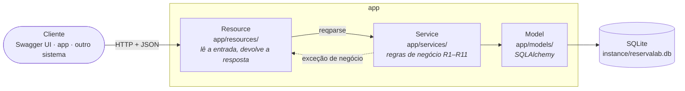

# ReservaLab API

API REST para reservar salas e laboratórios do campus, construída com **Flask-RESTful**.
Tem catálogo de salas, disponibilidade do dia e reservas com regras de negócio: conflito de horário, capacidade e permissões por papel.

Estudo de caso do seminário **"Flask-RESTful na prática: construindo uma API REST de reserva de laboratórios"**
· Disciplina TDS · UTFPR · Gabriel Carboneri.

A especificação completa (entidades, regras, endpoints e formato de erros) está em [docs/SPEC.md](docs/SPEC.md).

## Stack

Python 3.12 · Flask 3.1.3 · Flask-RESTful 0.3.10 · Flask-SQLAlchemy (SQLite) · Flask-JWT-Extended ·
flasgger (Swagger UI) · pytest + pytest-cov

## Arquitetura



- **Resource** só traduz HTTP: valida o formato com `reqparse`, chama o serviço e formata a saída com `marshal_with`.
- **Service** concentra as regras e não importa nada de Flask; uma regra violada vira exceção (`RegraViolada`, `ConflitoReserva`), que o Resource transforma no código HTTP certo.
- **Model** mapeia as tabelas `usuarios`, `salas` e `reservas`.

```
app/
├── __init__.py      create_app: cria a Api e registra as rotas
├── config.py        configurações (segredos vêm do .env)
├── extensions.py    db e jwt
├── auth.py          papel_requerido(...) e respostas do JWT
├── erros.py         erros em JSON e em português
├── parsers.py       entrada (reqparse)
├── campos.py        saída (fields / marshal_with)
├── comandos.py      flask init-db e flask seed
├── swagger.py       Swagger UI a partir de docs/swagger/*.yml
├── models/          Usuario, Sala, Reserva
├── resources/       camada HTTP
└── services/        regras de negócio
tests/               testes com pytest
docs/                especificação e documentação OpenAPI
```

## Como rodar

Requer **Python 3.12**.

**Windows (PowerShell)**

```powershell
py -3.12 -m venv .venv
.\.venv\Scripts\Activate.ps1
pip install -r requirements.txt
Copy-Item .env.example .env
flask --app app init-db
flask --app app seed
flask --app app run --debug
```

> Se o PowerShell recusar o `Activate.ps1` ("a execução de scripts foi desabilitada"), libere só para
> esta janela com `Set-ExecutionPolicy -Scope Process -ExecutionPolicy Bypass` e ative de novo.

**Linux / macOS**

```bash
python3.12 -m venv .venv
source .venv/bin/activate
pip install -r requirements.txt
cp .env.example .env
flask --app app init-db
flask --app app seed
flask --app app run --debug
```

**Chaves do `.env`:** troque `SECRET_KEY` e `JWT_SECRET_KEY` por valores aleatórios, gerados com
`python -c "import secrets; print(secrets.token_hex(32))"`. As chaves de exemplo funcionam, mas são curtas e públicas.

Depois de subir o servidor:

- **Swagger UI:** <http://localhost:5000/apidocs>. Faça `POST /auth/login`, clique em **Authorize** e cole o `access_token` para testar as rotas protegidas.
- **Health:** <http://localhost:5000/api/v1/health> → `{"status": "ok", "versao": "1.0.0"}`

O `flask --app app seed` pode rodar várias vezes sem duplicar dados. Para recomeçar do zero, apague `instance/reservalab.db` e rode `init-db` e `seed` de novo.

## Usuários de exemplo (criados pelo seed)

| Papel | E-mail | Senha |
|---|---|---|
| admin | admin@reservalab.dev | admin123 |
| professor | professor@reservalab.dev | prof123 |
| aluno | aluno@reservalab.dev | aluno123 |

O seed também cria 8 salas (blocos A, B e C, com 1 auditório e 1 sala inativa) e 6 reservas nos próximos dias úteis.
São dados de exemplo: não use essas senhas fora do ambiente local.

## Endpoints

Prefixo `/api/v1`. Rotas protegidas recebem `Authorization: Bearer <token>`.

| Método | Rota | Acesso | Sucesso |
|---|---|---|---|
| GET | `/health` | público | 200 |
| POST | `/auth/registro` | público (sempre cria aluno) | 201 |
| POST | `/auth/login` | público | 200 + `access_token` |
| GET | `/usuarios/me` | autenticado | 200 |
| GET | `/salas` | público; filtros `tipo`, `bloco`, `capacidade_min`, `recurso`, `ativa`; `page`, `per_page` | 200 |
| POST | `/salas` | admin | 201 + `Location` |
| GET | `/salas/<id>` | público | 200 |
| PUT | `/salas/<id>` | admin | 200 |
| DELETE | `/salas/<id>` | admin | 204 |
| GET | `/salas/<id>/disponibilidade?data=AAAA-MM-DD` | público | 200 |
| GET | `/reservas` | autenticado (aluno e professor veem as suas; admin vê todas); filtros `sala_id`, `data`, `status` | 200 |
| POST | `/reservas` | autenticado | 201 + `Location` |
| GET | `/reservas/<id>` | dono ou admin | 200 |
| DELETE | `/reservas/<id>` | dono ou admin (cancela, não apaga) | 204 |

## Regras de negócio

| Regra | Descrição | HTTP |
|---|---|---|
| R1 | `fim` depois de `inicio`; duração de 30 min a 4 h | 400 |
| R2 | Não é possível reservar no passado | 400 |
| R3 | Funcionamento das 07:30 às 22:30, início e fim no mesmo dia | 400 |
| R4 | Sem sobreposição com reserva confirmada da mesma sala (horários encostados não conflitam); a resposta mostra a reserva conflitante | 409 |
| R5 | Participantes não passam da capacidade da sala | 422 |
| R6 | Sala inativa não pode ser reservada | 422 |
| R7 | Auditório só para professor ou admin | 403 |
| R8 | Aluno tem no máximo 3 reservas futuras confirmadas | 422 |
| R9 | Só o dono ou o admin cancela; reserva já cancelada ou já iniciada não pode ser cancelada | 204 / 404 / 409 |
| R10 | Só o admin cria, edita ou exclui salas; sala com reservas futuras não pode ser excluída | 403 / 409 |
| R11 | O registro público sempre cria o papel aluno | — |

Ordem de validação ao criar uma reserva (a primeira regra violada decide a resposta):
formato (400) → R1, R2, R3 (400) → sala existe (404) → R6 (422) → R7 (403) → R5 (422) → R8 (422) → R4 (409).

## Códigos HTTP usados

| Código | Quando | Por quê |
|---|---|---|
| 200 OK | leituras, login, PUT | sucesso com corpo |
| 201 Created | registro, criação de sala e de reserva | recurso novo criado; `Location` diz onde ele está |
| 204 No Content | exclusão de sala e cancelamento de reserva | deu certo e não há nada para devolver |
| 400 Bad Request | campo inválido, JSON malformado, R1–R3 | o pedido em si está errado |
| 401 Unauthorized | sem token, token inválido ou expirado, login errado | não sabemos quem é você |
| 403 Forbidden | papel sem permissão (R7, R10) | sabemos quem é você, mas você não pode fazer isso |
| 404 Not Found | sala ou reserva inexistente; reserva de outra pessoa | não existe (ou não revelamos que existe) |
| 405 Method Not Allowed | método que a rota não aceita | a rota existe, o verbo não |
| 409 Conflict | conflito de horário (R4), código ou e-mail repetido, cancelamento inválido (R9), sala com reservas (R10) | o pedido é válido, mas choca com o estado atual |
| 415 Unsupported Media Type | corpo sem `Content-Type: application/json` | a API só aceita JSON |
| 422 Unprocessable Entity | sala inativa (R6), capacidade (R5), limite do aluno (R8) | formato certo, mas viola uma regra de negócio |
| 500 Internal Server Error | erro inesperado | falha do servidor; resposta em JSON, sem detalhes internos |

Todos os erros saem como `{"message": "..."}` em português. Erros de validação de campo saem como `{"message": {"campo": "explicação"}}`.

## Validação de entrada

| Entrada inválida | Resposta |
|---|---|
| `null` num campo do corpo (`"nome": null`) | 400 com a mensagem do campo |
| Corpo JSON que não é objeto (`[...]`, `"texto"`) | 400 "o corpo deve ser um objeto JSON" |
| Booleano ou decimal num campo inteiro (`"capacidade": true` ou `12.7`) | 400 (`12.0` é aceito como 12) |
| Inteiro acima do limite do SQLite (2⁶³−1) | 400 no corpo e na query string; 404 se for id na URL |
| Item de `recursos` com vírgula | 400 (a lista é guardada separada por vírgulas) |

## Testes

```bash
pytest -q
pytest -q --cov=app --cov-report=term-missing --cov-fail-under=85
```

São 229 testes, com cobertura de 99% em `app/`. Cada regra (R1–R11) tem testes com a regra no nome (`test_r4_...`). A checagem de conflito de horário e o cálculo da disponibilidade têm testes unitários puros, sem HTTP nem banco (`tests/test_unidades.py`).

## Onde cada conceito do Flask-RESTful aparece

| Conceito | Arquivo | Trecho |
|---|---|---|
| `Resource` (um método por verbo HTTP) | [app/resources/health.py](app/resources/health.py) | `HealthResource.get` |
| `Api` e `add_resource` | [app/__init__.py](app/__init__.py) | `ApiReservaLab(app, prefix="/api/v1")` e `api.add_resource(...)` |
| Dois Resources por entidade (coleção e item) | [app/resources/salas.py](app/resources/salas.py) | `SalaListResource` e `SalaResource` |
| `reqparse` (validação da entrada) | [app/parsers.py](app/parsers.py) | `sala_parser`, `reserva_parser`, `choices`, `type`, `help` |
| `fields` e `marshal_with` (formato da saída) | [app/campos.py](app/campos.py) | `sala_campos`, `reserva_campos`, `paginado()` |
| `fields.Nested` e `fields.Url` | [app/campos.py](app/campos.py) | `reserva_campos["sala"]`, `sala_campos["url"]` |
| `abort` e códigos HTTP | [app/resources/salas.py](app/resources/salas.py) | `obter_sala_ou_404`, `return sala, 201, {"Location": ...}` |
| `method_decorators` | [app/resources/reservas.py](app/resources/reservas.py) | `[traduzir_erros, jwt_required()]` |
| Erros personalizados da `Api` | [app/erros.py](app/erros.py) | `ApiReservaLab.handle_error` |
| Regras de negócio fora do HTTP | [app/services/reservas.py](app/services/reservas.py) | docstring com a ordem de validação |
| Autenticação JWT por papel | [app/auth.py](app/auth.py) | `papel_requerido("admin")` |
| Documentação Swagger | [app/swagger.py](app/swagger.py) e [docs/swagger/](docs/swagger/) | YAML por tag, fora dos Resources |
